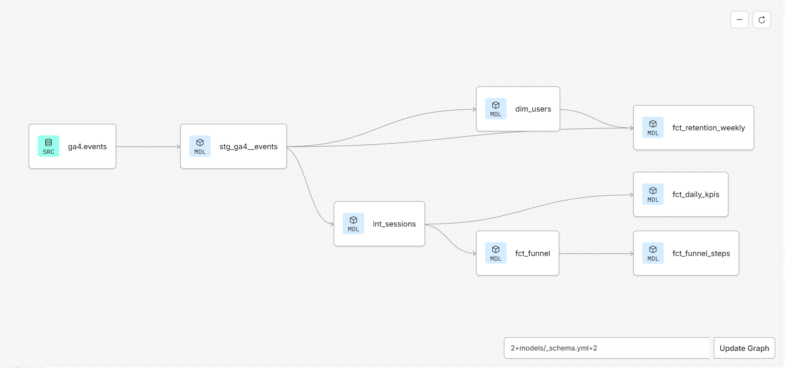

# Where do online shoppers drop out, and what would I test to fix it?

Product analytics on Google's GA4 sample data (Google Merchandise Store, Nov 2020 to Jan 2021), built with SQL, dbt, BigQuery and Data Studio (formerly Looker Studio).

**[Live dashboard](https://datastudio.google.com/s/ijUBLawOYaM)** · [Experiment plan](experiment_plan.md) · [Exploration notes](notes.md)

## Key findings (2 Nov 2020 to 31 Jan 2021)

1. **The biggest leak is the first step.** Only 19.8% of sessions that viewed a product added it to the cart (15,172 of 76,483). Every later step converts at 39% to 74%.
2. **Device is not the problem.** Full-funnel conversion is 0.83% on mobile, 0.78% on tablet and 0.77% on desktop.
3. **Few new users come back.** Of new users in each November weekly cohort, only 4.3% to 5.7% returned the following week, and under 2% by week 4.

Overall: 357,504 sessions, 4,835 orders, 1.35% conversion, $361,392 revenue.

## Recommendation

Test showing delivery cost and expected delivery date next to the Add to cart button.

- Primary metric: add-to-cart rate (baseline 19.8%)
- Guardrails: overall conversion, revenue per session, checkout-to-purchase rate
- About 6,580 sessions per group to detect a 10% relative lift, so 3 full weeks at current traffic

Full design, decision rule and risks: [experiment_plan.md](experiment_plan.md)

## Funnel

| Step | Sessions | Step conversion |
|---|---|---|
| 1 Viewed item | 76,483 | |
| 2 Added to cart | 15,172 | 19.8% |
| 3 Began checkout | 5,958 | 39.3% |
| 4 Payment info | 3,857 | 64.7% |
| 5 Purchased | 2,848 | 73.8% |

## How I built it

Raw GA4 events → staging → sessions → marts → dashboard, all in dbt on BigQuery.

| Model | One row per | Purpose |
|---|---|---|
| `stg_ga4__events` | event | Clean names, real dates, session ID pulled from nested event_params |
| `int_sessions` | session | 1/0 flag for each funnel step, revenue |
| `dim_users` | user | First visit, cohort week, new-user flag |
| `fct_daily_kpis` | day | Sessions, orders, conversion, revenue |
| `fct_funnel` / `fct_funnel_steps` | day × device × channel | Funnel counts, and the same in long format for charts |
| `fct_retention_weekly` | cohort × week | Weekly retention of new users |

Tests: `unique` and `not_null` on session, user and date keys.

Design choices:
- A session is `user_pseudo_id` + `ga_session_id`, as session IDs alone repeat across users.
- The funnel counts a session at a step only if it also reached every earlier step, so the funnel always narrows. Step order within the session is not checked.
- Conversion on the dashboard is total orders divided by total sessions, not an average of daily rates.

## Checks and limitations

- **Reconciliation:** total sessions match across `fct_daily_kpis` and `fct_funnel` (360,129 in the full dataset).
- **Funnel coverage:** the strict funnel captures 2,848 of 4,848 purchasing sessions (it misses 41.3%), because some purchases have no earlier funnel events in this dataset. Funnel rates describe sessions that went through every step.
- **Obfuscated data:** Google scrambled parts of this sample, so some values are missing or masked.
- **First-touch channel:** `traffic_source` is the channel that first brought the user, not the channel of each visit.
- **Right-censoring:** later cohorts have fewer weeks of retention data because the data ends on 31 Jan 2021.
- **Season:** the period includes the Christmas peak, so results may not hold year-round.
- **Shop data, not fintech:** the same method maps onto a money-transfer flow (quote, start transfer, recipient, payment, funded).

## Run it yourself

1. Create a BigQuery project and a dataset in the US location.
2. Connect dbt to BigQuery with a service account (BigQuery Data Editor, Job User and Read Session User roles).
3. Run `dbt build`.
